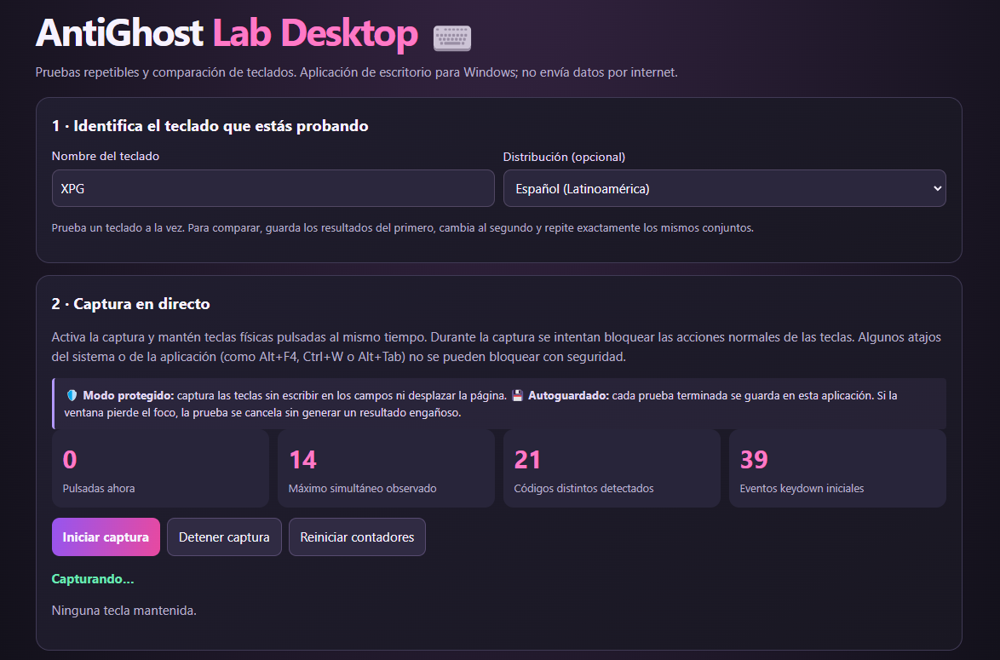
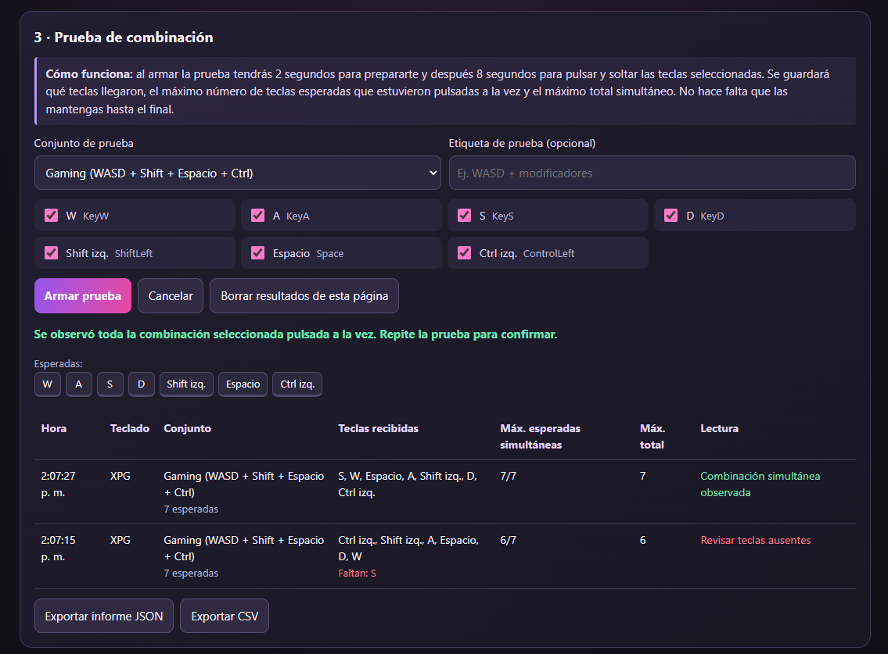
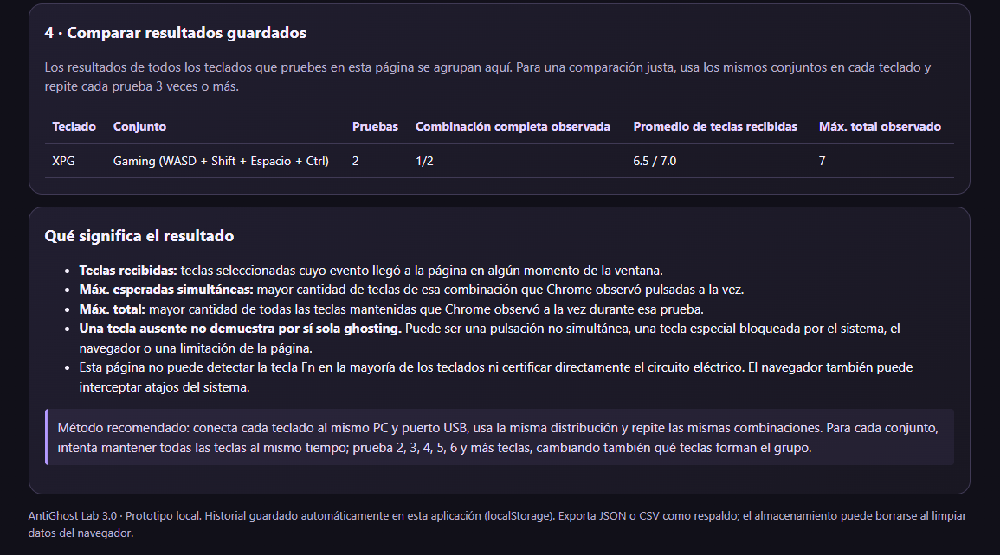

Herramienta gratuita para Windows que permite probar pulsaciones simultáneas, detectar posibles limitaciones de anti-ghosting y comparar el comportamiento de distintos teclados.

# AntiGhost Lab Desktop

AntiGhost Lab Desktop es una herramienta gratuita para Windows que permite comprobar cómo responde un teclado al presionar varias teclas al mismo tiempo.

El proyecto nació de algo bastante simple: quería comparar dos teclados y saber cuál respondía mejor a determinadas combinaciones, especialmente al jugar. Como las especificaciones de los fabricantes no siempre reflejan cómo se comporta un teclado en situaciones reales, decidí crear una herramienta para hacer mis propias pruebas.

La aplicación permite visualizar las teclas detectadas en tiempo real, realizar pruebas con distintas combinaciones y guardar los resultados para compararlos después.

## Capturas de pantalla

### Ventana principal


### Prueba de teclas


### Resultados


## Funciones

- Detección de pulsaciones en tiempo real.
- Contador de teclas presionadas simultáneamente.
- Pruebas guiadas con combinaciones predefinidas.
- Posibilidad de probar combinaciones personalizadas.
- Historial de pruebas y comparación entre teclados.
- Guardado automático de los resultados completados.
- Exportación de resultados en JSON y CSV.
- Aplicación portátil para Windows.

## Descarga

Puedes descargar la versión más reciente desde la sección de [Releases](../../releases).

Solo necesitas descargar el archivo `.exe` y ejecutarlo. No es necesario instalar Node.js ni Chrome.

Es posible que Windows SmartScreen muestre una advertencia porque el ejecutable no cuenta con una firma digital.

## Cómo utilizarlo

1. Abre AntiGhost Lab Desktop.
2. Ingresa el nombre del teclado que quieres probar.
3. Inicia la captura de teclas o selecciona una de las pruebas guiadas.
4. Presiona las combinaciones indicadas.
5. Revisa los resultados y repite las pruebas con otro teclado si quieres compararlos.

Para obtener comparaciones más consistentes, es recomendable utilizar el mismo equipo, la misma distribución de teclado y las mismas combinaciones en cada prueba.

## Compilar desde el código fuente

Para ejecutar o compilar el proyecto necesitas tener instalado [Node.js](https://nodejs.org/).

Descarga el repositorio e instala las dependencias:

```bash
npm install
```

Para iniciar la aplicación:

```bash
npm start
```

Para generar el ejecutable de Windows puedes utilizar el archivo `CREAR_EXE_WINDOWS.bat` incluido en el proyecto.

## Limitaciones

AntiGhost Lab registra los eventos de teclado que recibe la aplicación. No puede analizar directamente el circuito interno del teclado ni determinar con certeza su capacidad física de anti-ghosting o key rollover.

Algunas combinaciones de teclas son utilizadas directamente por Windows y no pueden bloquearse desde la aplicación, por lo que determinadas pruebas podrían no realizarse correctamente.

Los resultados sirven como referencia para observar y comparar el comportamiento de distintos teclados, pero no constituyen una certificación técnica del hardware.

## Privacidad

Los resultados se almacenan localmente en el equipo. No es necesario crear una cuenta ni disponer de conexión a Internet para realizar las pruebas.

## Licencia

Este proyecto se distribuye bajo la licencia MIT. Puedes consultar los términos en el archivo [LICENSE](LICENSE).
